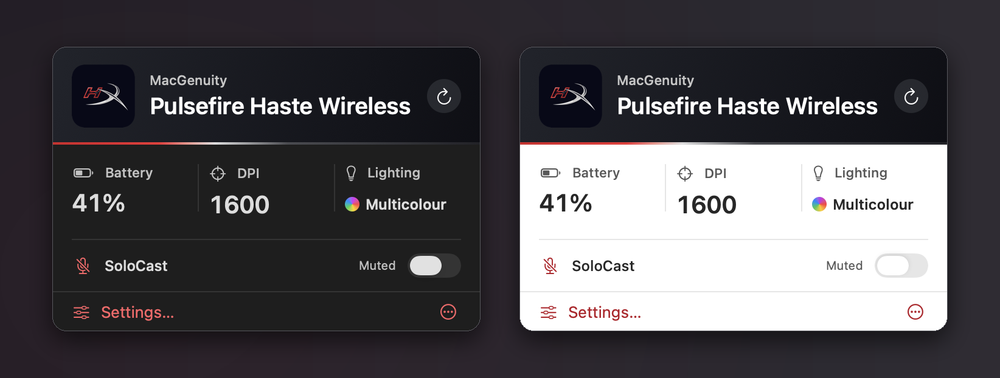

<p align="center">
  
</p>
<h1 align="center">MacGenuity</h1>
<p align="center">Your HyperX mouse and microphone, one click from the macOS menu bar.</p>
<p align="center">
  <a href="https://github.com/loujessler/MacGenuity/releases/latest"></a>
  
  
  <a href="LICENSE"></a>
</p>
<p align="center">
  <a href="https://github.com/loujessler/MacGenuity/releases/latest"><strong>Download for macOS</strong></a> ·
  <a href="#device-support">Device support</a> ·
  <a href="#build-from-source">Build from source</a> ·
  <a href="CHANGELOG.md">Release notes</a>
</p>



## Install

1. Download the universal DMG from the [latest release](https://github.com/loujessler/MacGenuity/releases/latest).
2. Open the image, drag **MacGenuity** to **Applications**, then launch the installed app.
3. Click the battery or HyperX icon in the menu bar. Open **Settings → Devices** to configure a peripheral.

**Already on 0.4.0 or later?** Open **Check for Updates…** in the menu, or use **Settings → General → Check for Updates…**. In 1.0 the menu command lives under **More (•••)**. Sparkle verifies the signed feed and download. Automatic checks and installation are configurable in General. Earlier versions need one manual DMG upgrade.

<details>
<summary>First launch, Gatekeeper and USB permissions</summary>

Public builds use an ad-hoc signature and ship without Apple notarization. Each release includes a <code>SHA256SUMS</code> file. Download it alongside the DMG and run <code>shasum -a 256 -c SHA256SUMS</code> in the download directory. If Gatekeeper blocks the verified app, use <strong>System Settings → Privacy &amp; Security → Open Anyway</strong> when macOS offers it.

MacGenuity opens the Haste receiver's vendor-defined USB interface directly. If macOS requires Input Monitoring for a device, the app offers <strong>Open System Settings…</strong> and <strong>Relaunch</strong>. With an ad-hoc build, an update can require granting access again. A stale entry can be reset under <strong>Already enabled?</strong> in the permission window. Microphone controls use CoreAudio.

</details>

## In the menu bar

| At a glance | In device settings |
| --- | --- |
| Battery percentage, charging and low-battery indicator | Battery history for the last 10 hours and trend. Alert threshold and refresh interval are in General. |
| Active DPI and wheel colour on the original Haste Wireless | Five DPI levels with indicator colours, wheel effects, intensity and named lighting presets |
| Microphone mute state and a switch when the device supports it | Input level, default input and device properties |
| A sleeping receiver prompts you to wake the mouse | Firmware, USB IDs and last battery reading |

Opening the menu refreshes the original Haste Wireless from the receiver. A physical DPI-button change is reflected on the next read. Single-colour effects have a swatch and hex value. A cycling palette shows **Multicolour**, and zero brightness shows **Off**.

## Device support

| Device | Available controls | Verification |
| --- | --- | --- |
| **Pulsefire Haste Wireless** (PF002) | Battery, wheel lighting, active DPI, five editable levels, button assignments and firmware | USB receiver `03F0:028E` tested on hardware. Cable `03F0:048E` uses the same control protocol. |
| **Pulsefire Haste 2 Wireless** | Battery monitoring through receiver `03F0:0F98` | Numbered HID reports checked against two independent clients and covered by packet tests. Hardware confirmation is still open. |
| **SoloCast** | CoreAudio mute, input level, sample rate and default-input status, as exposed by the device | Detected on hardware. Mute and level controls follow the CoreAudio write capabilities. |
| **QuadCast 2 S** | Per-LED colour, spatial effects, 108-LED painter, 32-frame animation editor and return to firmware animation | Captured USB descriptors, 12 × 9 lamp geometry and dedicated protocol and renderer tests. |
| **Other Cast microphones** | CoreAudio properties and available audio controls | Audio features depend on the model. RGB control is specific to QuadCast 2 S. |
| **Other Pulsefire mice** | Generic NGENUITY protocol for compatible mice | Support varies by firmware and model. The original Haste and Haste 2 each have a dedicated profile. |

**Original Haste Wireless.** Choose Static, Breathing, Spectrum or Trigger fade. Brightness and colour intensity scale the frames stored in the mouse. Live preview saves once edits settle. DPI ranges from 200 to 16,000 in steps of 100. Remap the middle, side and DPI buttons from the Buttons section.

The rear side button sends **Mouse4** and the front sends **Mouse5** by default. Apps and games decide what these buttons do. If you saved keyboard shortcuts with 1.0.1 or 1.0.2, open **Settings → Devices → Buttons**, choose **Mouse → Back** for **Side back** and **Mouse → Forward** for **Side forward**, then click **Apply** to restore the native bindings on the mouse.

**Protocol references.** The original Haste implementation uses NGENUITY USB captures. The Haste 2 battery profile has a separate report format. [Haste captures](https://github.com/evan-razzaque/open-pulsefire-haste/tree/294f7f0edf6d8f4e1db668d08a85828c452c9f69/captures) · [PF002 protocol](https://github.com/okms/haste-control/blob/472226f96dfc50ecc81f3657b615cea109651f1a/docs/PROTOCOL.md) · [Haste 2 Linux client](https://github.com/Tammo0987/hyperx-battery/blob/2cac0deb57efd5979a76d89394929484d612848b/src/device.rs) · [Haste 2 cross-platform client](https://github.com/vitaliishchudlo/haste2-battery-status/blob/main/src/haste2_battery/protocol.py) · [QuadCast 2 S protocol notes](docs/quadcast-2s-protocol.md)

**Candidates for future profiles.** The Alloy Origins Core keyboard, Fury Ultra and Pulsefire Mat have published OpenRGB implementations. They are candidates for device testing and integration in MacGenuity. [Alloy Origins Core](https://github.com/CalcProgrammer1/OpenRGB/tree/master/Controllers/HyperXKeyboardController/HyperXAlloyOriginsCoreController) · [HyperX mouse mats](https://github.com/CalcProgrammer1/OpenRGB/tree/master/Controllers/HyperXMousematController)

## Build from source

Install Xcode Command Line Tools and build from the repository root.

```bash
xcode-select --install
./build.sh
open build/MacGenuity.app
```

For a universal release image, run the following commands. The packaging script mount-tests the DMG, checks the bundle signature and verifies the Applications link.

```bash
HYPERX_UNIVERSAL=1 HYPERX_SIGN_IDENTITY=- HYPERX_ALLOW_DEBUG=0 ./build.sh
bash tools/package-dmg.sh
```

<details>
<summary>Architecture, tests and releases</summary>

The SwiftUI scenes in <code>MacGenuity/Features</code> observe a main-actor <code>DeviceViewModel</code>. USB transactions run on the HID service actor. Profiles provide matching, packet encoding and reply parsing. Microphone state comes from CoreAudio property listeners. Sparkle handles distribution updates.

```bash
bash Tests/Regression/run.sh
bash Tests/QuadCast2S/run.sh
python3 Tests/Regression/installer_test.py
python3 Tests/Regression/relaunch_test.py
python3 Tests/Regression/relaunch_test.py --reset
```

For local development, <code>build.sh</code> selects <code>HYPERX_SIGN_IDENTITY</code>, a local <code>MacGenuity Dev</code> identity, an Apple Development identity, or ad-hoc signing, in that order. A stable signing identity lets macOS recognise subsequent builds for privacy grants. Set <code>HYPERX_ALLOW_DEBUG=0</code> for distribution.

Stable releases increment the public version and the internal bundle number, add an entry to <code>CHANGELOG.md</code>, and tag the commit <code>vX.Y.Z</code>. CI runs tests on Apple Silicon and Intel, then publishes the universal DMG, its checksum and the Ed25519-signed Sparkle feed.

</details>

## Diagnostics and contributions

Open **More → Diagnostics…** to inspect USB interfaces, see which profile matched and copy filtered logs. Local logs rotate at 5 MB in <code>~/Library/Logs/MacGenuity/MacGenuity.log</code>. When reporting a compatibility issue, include the model, connection type, VID/PID and the control that failed. [Profile authoring guide](MacGenuity/Infrastructure/HID/Profiles/PROFILES.md) · [Contributing](CONTRIBUTING.md)

MacGenuity is an independent, MIT-licensed project. Contributions help cover more hardware revisions. [Support development](https://loujessler.github.io/MacGenuity/) · [License](LICENSE)
